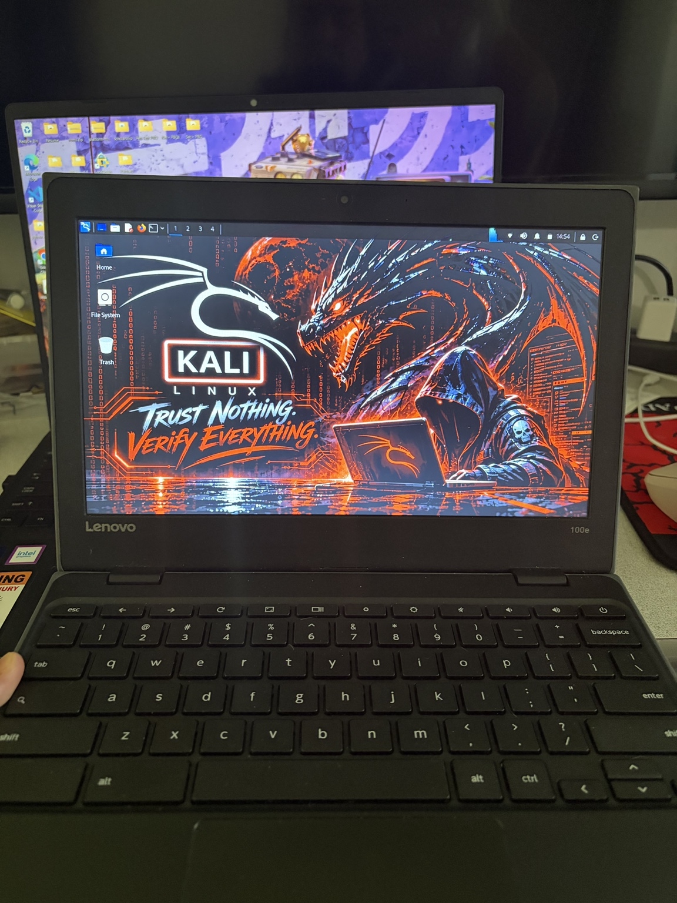

# 🐉 Kali Dragon - Custom Scripts and Configurations

[← Return to Project Overview](README.md)

## Overview

Kali Dragon was designed to be more than a standard Kali Linux installation. I wanted to create a personalized cybersecurity workstation that reflected my Zer0Trust404 identity while developing practical Linux administration and system customization skills.

## 1. Custom Zer0Trust404 Dashboard

The custom dashboard provides real-time system information while maintaining a black and neon-green cybersecurity theme.

### Features

- CPU utilization monitoring
- Memory utilization monitoring
- Real-time system information
- Custom Zer0Trust404 branding
- Cyberpunk-inspired interface

## 2. Ghost Terminal

A custom terminal overlay was implemented to enhance the appearance of the desktop environment while maintaining access to Linux command-line functionality.

### Objectives

- Create an integrated terminal experience
- Maintain a lightweight desktop environment
- Develop familiarity with Linux customization
- Improve desktop usability

## 3. Cyberpunk Activity Log

A custom activity log was developed to complement the Zer0Trust404 dashboard and create a cybersecurity-inspired workstation interface.

## 4. Desktop Customization

The desktop environment was personalized to reflect the Kali Dragon project identity.

### Customizations

- Custom dragon wallpaper
- Zer0Trust404 branding
- Personalized terminal appearance
- Black and neon-green color scheme
- Customized desktop layout

## 5. Desktop Showcase

## 6. Technical Skills Developed

- Linux system administration
- Command-line operations
- System resource monitoring
- Script customization
- Desktop environment configuration
- Resource management
- Technical documentation
- Troubleshooting and problem-solving

## 7. Source Code and Configuration Files

The original scripts and configuration files will be collected directly from Kali Dragon, reviewed, and added to this repository.

| Component | Status |
|---|---|
| Zer0Trust404 Dashboard | Implemented |
| Ghost Terminal | Implemented |
| Cyberpunk Activity Log | Implemented |
| Desktop Customization | Implemented |
| Source Code Documentation | Pending |

## 8. Future Improvements

- Publish original scripts and configuration files
- Improve dashboard functionality
- Optimize system resource consumption
- Expand system monitoring capabilities
- Continue developing custom cybersecurity utilities

---

**Project:** Kali Dragon

**Developer:** Zer0Trust404

**Status:** Operational / Continuous Development

*Trust Nothing. Verify Everything.*
