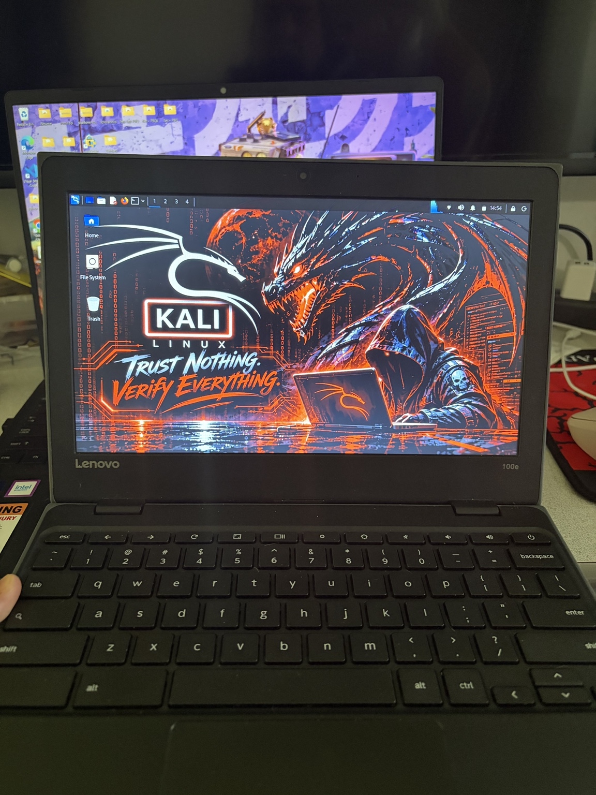

# 🐉 Kali Dragon - Installation Documentation

[← Return to Project Overview](README.md)

## Project Objective

Transform a Lenovo 100e Chromebook into a standalone Kali Linux cybersecurity workstation by replacing the original firmware and operating system.

This project was completed as a personal hands-on learning experience outside of my Computer Science coursework.

## 1. Hardware and Tools

### Hardware

- Lenovo 100e Chromebook
- Google Robo Rev3 / Coral board
- x86_64 architecture
- USB flash drive
- 45W USB-C power adapter
- Windows 11 workstation
- Precision screwdriver kit

### Software

- ChromeOS Developer Mode
- MrChromebox Firmware Utility
- Kali Linux Installer
- Rufus
- Linux command-line utilities

## 2. Enable Developer Mode

The first stage involved enabling Developer Mode to gain access to the Chromebook's underlying system.

- Entered Chromebook Recovery Mode.
- Enabled Developer Mode.
- Accessed the ChromeOS terminal.
- Established access to the developer shell.
- Identified the system architecture and board.

### Result

Developer-level system access was successfully established.

## 3. Disable Hardware Write Protection

The Chromebook's firmware was protected against unauthorized modification.

To proceed with the firmware replacement, I needed to disable hardware write protection.

### Process

1. Powered down the Chromebook.
2. Disconnected the external power supply.
3. Removed the bottom cover.
4. Located and disconnected the internal battery.
5. Accessed the system using external power.
6. Verified that firmware write protection was disabled.

### Result

Hardware write protection was successfully disabled, allowing firmware modification.

> WARNING: Write protection methods vary between Chromebook models. Incorrect firmware modifications can render a device unusable.

## 4. Firmware Modification

The MrChromebox Firmware Utility was used to replace the original Chromebook firmware.

### Challenges Encountered

- Firmware write protection restrictions.
- Script execution restrictions.
- Filesystem mounted with the noexec option.
- External boot configuration.

### Solutions

- Disabled hardware write protection.
- Executed the firmware utility from an appropriate writable and executable location.
- Configured alternative boot support.
- Ultimately installed UEFI Full ROM firmware.

### Result

The Chromebook successfully transitioned to UEFI firmware, allowing a standalone Linux installation.

## 5. Create Kali Linux Installation Media

A Windows 11 workstation was used to prepare the installation media.

### Process

1. Obtained the Kali Linux installer image.
2. Connected a USB flash drive.
3. Opened Rufus.
4. Selected the Kali Linux ISO.
5. Created the bootable installation media.
6. Connected the USB drive to the Chromebook.
7. Booted into the Kali Linux installer.

## 6. Install Kali Linux

The graphical installation method was selected.

### Installation Process

- Booted from the installation USB.
- Selected Graphical Install.
- Configured the operating system.
- Configured storage and installation settings.
- Installed the base system.
- Completed the installation.
- Rebooted into Kali Linux.

### Result

Kali Linux successfully booted on the Chromebook without relying on ChromeOS.

## 7. Post-Installation Configuration

Following installation, additional configuration was required to improve system functionality.

### Networking

- Established wireless connectivity.
- Verified internet access.
- Tested network performance.

### Audio

- Investigated missing audio functionality.
- Examined available audio devices.
- Used ALSA and PulseAudio diagnostic utilities.
- Restored internal speaker and headphone functionality.

### Storage

- Configured additional microSD storage.
- Verified storage accessibility.

### Desktop Customization

- Created a personalized cybersecurity desktop.
- Implemented a custom system monitoring dashboard.
- Added CPU and memory monitoring.
- Developed a ghost terminal overlay.
- Added a cyberpunk-inspired activity log.
- Integrated Zer0Trust404 branding.

## 8. System Verification

The following commands are useful for verifying the installed system.

### Verify System Architecture

```bash
uname -m
```

### Verify Operating System

```bash
cat /etc/os-release
```

### Verify UEFI Boot Mode

```bash
ls /sys/firmware/efi
```

### Display Processor Information

```bash
lscpu
```

### Display Memory Information

```bash
free -h
```

### Display Storage Devices

```bash
lsblk
```

### Display Network Interfaces

```bash
ip -brief address
```

## 9. Installation Results

| Component | Status |
|---|---|
| Developer Mode | Successful |
| Hardware Write Protection | Disabled |
| UEFI Firmware | Installed |
| Kali Linux | Operational |
| Wireless Networking | Operational |
| Internal Speakers | Operational |
| Headphone Audio | Operational |
| Additional Storage | Operational |
| Custom Desktop | Operational |
| Battery Management | Under Investigation |

## 10. Final Result

<p align="center">
  
</p>

The completed Kali Dragon workstation demonstrates the successful repurposing of Chromebook hardware into a personalized Linux-based cybersecurity lab.

## 11. Lessons Learned

This project taught me that installing an operating system is only one part of building a functional workstation.

Firmware compatibility, hardware restrictions, device drivers, power management, and troubleshooting all play important roles in system reliability.

Working through these challenges strengthened my confidence in Linux administration, hardware troubleshooting, and technical problem-solving.

## 12. References

- [MrChromebox Firmware](https://mrchromebox.tech/)
- [Kali Linux](https://www.kali.org/)
- [Kali Linux Documentation](https://www.kali.org/docs/)
- [Rufus](https://rufus.ie/)

## Disclaimer

This documentation describes my personal project experience and is not a universal Chromebook conversion guide. Hardware compatibility and firmware requirements vary between devices.

---

**Developed by Zer0Trust404**

**Trust Nothing. Verify Everything.**

🐉 KALI DRAGON ONLINE
