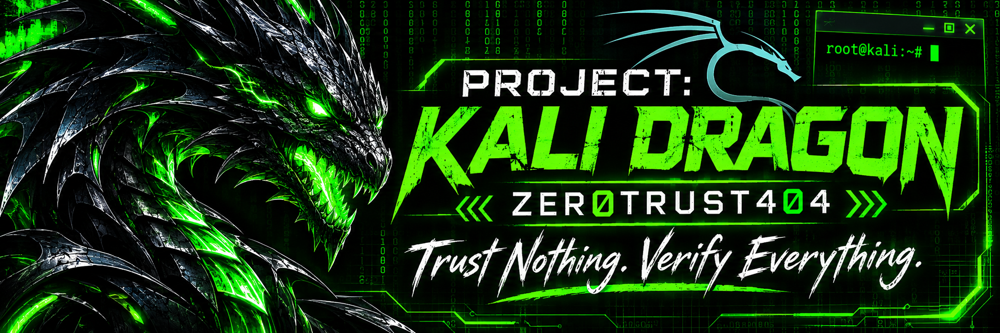
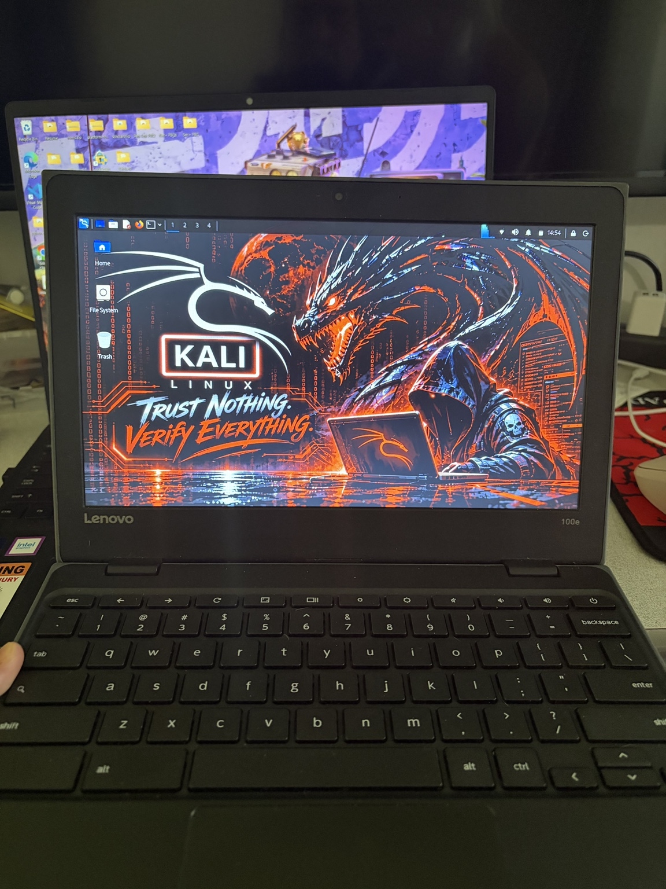

# 🐉 PROJECT: KALI DRAGON

### Trust Nothing. Verify Everything.

## 🎯 Project Overview

Kali Dragon is a personal cybersecurity project focused on transforming a repurposed Chromebook into a portable Kali Linux cybersecurity workstation.

As a Computer Science student pursuing a career in cybersecurity, I wanted to challenge myself beyond the classroom by working directly with hardware, firmware, Linux administration, and system customization.

This project documents my hands-on experience, technical challenges, troubleshooting process, and continued development of a personalized cybersecurity lab.

## 📚 Project Documentation

| Document | Description |
|---|---|
| [Installation Guide](INSTALLATION.md) | Chromebook to Kali Linux conversion process |
| Hardware Specifications | Coming soon |
| Troubleshooting Log | Coming soon |
| Power Management Investigation | In progress |
| Custom Scripts and Configurations | Coming soon |

## 💻 System Specifications

| Component | Details |
|---|---|
| Hardware | Lenovo 100e Chromebook |
| Board | Google Robo Rev3 / Coral |
| Architecture | x86_64 |
| Operating System | Kali Linux |
| Firmware | MrChromebox UEFI Full ROM |
| Interface | Custom Zer0Trust404 Dashboard |
| Project Status | Operational / Ongoing Development |

## ⚙️ Project Milestones

- [x] Enable Chromebook Developer Mode
- [x] Disable hardware write protection
- [x] Install custom UEFI firmware
- [x] Create bootable Kali Linux installation media
- [x] Install Kali Linux
- [x] Configure wireless networking
- [x] Troubleshoot and restore audio functionality
- [x] Create custom system monitoring dashboard
- [x] Implement ghost terminal overlay
- [x] Implement cyberpunk activity log
- [ ] Resolve battery and power management issues
- [ ] Expand cybersecurity lab capabilities
- [ ] Publish additional scripts and documentation

## 🛠️ Tools and Technologies

- Kali Linux
- MrChromebox Firmware Utility
- Rufus
- Bash
- Linux Terminal
- UEFI Firmware
- ALSA and PulseAudio
- Conky
- Linux Networking Utilities

## 🔧 Challenges and Solutions

### Firmware Modification

Successfully disabled hardware write protection and replaced the original Chromebook firmware with UEFI firmware to support a standalone Linux installation.

### Audio Troubleshooting

Investigated Linux audio compatibility issues using ALSA and PulseAudio utilities. Successfully restored functionality to the internal speakers and headphones.

### System Customization

Developed a personalized black and neon-green cybersecurity interface featuring system monitoring, a ghost terminal, and a cyberpunk-inspired activity log.

### Power Management

Currently investigating unexpected battery discharge and boot behavior. Documenting test results to identify potential firmware, hardware, or operating system causes.

## 🧠 Technical Skills Demonstrated

- Linux installation and administration
- Hardware and firmware troubleshooting
- Command-line proficiency
- Operating system configuration
- Network configuration
- Bash scripting
- System monitoring
- Technical documentation
- Analytical problem-solving

## 📸 Project Gallery

Project photographs and screenshots coming soon.

## 🔮 Future Development

- Expand the portable cybersecurity lab
- Develop additional automation scripts
- Improve system performance
- Document authorized security testing
- Continue hardware and software experimentation

## ⚠️ Ethical Use

## 📸 Project Gallery

### Kali Dragon - Operational

  

The Lenovo 100e Chromebook running Kali Linux after
successful firmware modification, operating system
installation, and desktop customization.

## 👤 About the Developer

**Zer0Trust404**

Computer Science student, former professional MMA fighter, and aspiring cybersecurity professional with an interest in penetration testing, ethical hacking, hardware experimentation, and Linux systems.

---

### 🐉 KALI DRAGON ONLINE

**Trust Nothing. Verify Everything.**
